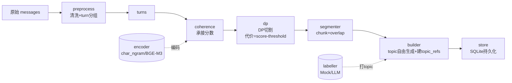
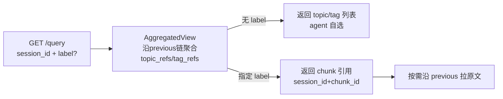
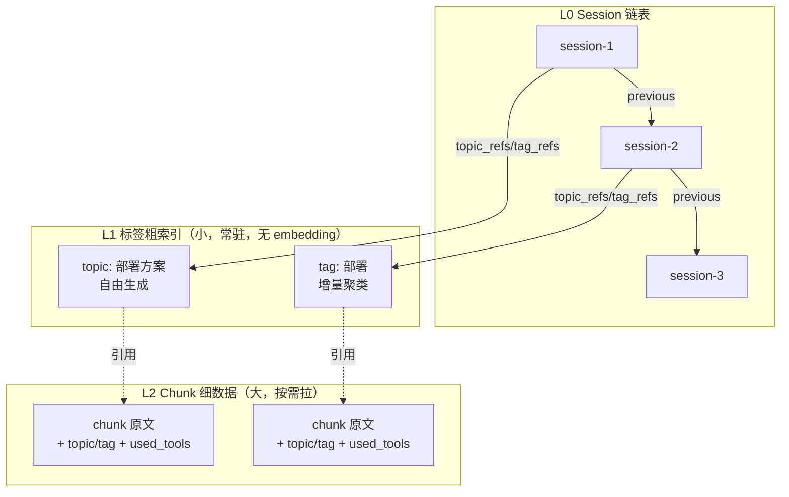

# LongerSession 架构

## 总览

```
┌─────────────────────────────────────────────────────────────┐
│                          API 层                              │
│   POST /process（建索引）     GET /query（结构化定位）         │
└───────────────┬───────────────────────┬─────────────────────┘
                │                       │
        ┌───────▼────────┐      ┌───────▼────────┐
        │   Service 编排  │      │   Service 编排  │
        └───────┬────────┘      └───────┬────────┘
                │                       │
   ┌────────────▼────────────────────────▼─────────────┐
   │                   处理管线                          │
   │  preprocess → coherence → dp → segmenter → builder │
   └──────┬──────────┬──────────┬──────────┬───────────┘
          │          │          │          │
   ┌──────▼───┐ ┌────▼────┐ ┌───▼─────┐ ┌───▼─────┐
   │ encoder  │ │ labeller│ │  store  │ │tag聚类  │
   │ (可插拔) │ │ (自由)  │ │ SQLite  │ │(离线)   │
   └──────────┘ └─────────┘ └─────────┘ └─────────┘
```

## 模块分层

```
src/longersession/
├── api/            # 对外接口层
│   ├── app.py         # FastAPI（POST /process、GET /query 结构化）
│   ├── service.py     # 编排：串起全部组件
│   └── schemas.py     # 请求/响应模型
├── segmentation/   # 切割管线
│   ├── preprocess.py  # 消息清洗 + turn 分组
│   ├── coherence.py   # 承接分数（相邻 turn 余弦相似度）
│   ├── dp.py          # DP 切割（切点代价 = score - threshold）
│   └── segmenter.py   # 编排：分数→DP→chunk（含 overlap）
├── encoder/        # 可插拔编码器（只用切割 + tag 聚类）
│   ├── base.py        # Encoder 抽象
│   ├── mock.py        # MockEncoder（字符级，无模型）
│   ├── word_bag.py    # WordBagEncoder（词级，英文）
│   ├── char_ngram.py  # CharNGramEncoder（字符 n-gram，中英通用）
│   ├── bge_m3.py      # BGEM3Encoder（lazy load）
│   └── factory.py     # 工厂
├── topic/          # topic 标签器
│   └── labeller.py    # Mock/LLM（自由生成，无受控词典）
├── index/          # 索引与存储
│   ├── store.py       # SQLite（sessions/turns）
│   ├── builder.py     # SessionIndex 构建（topic 自由 + topic_refs）
│   ├── aggregate.py   # AggregatedView（topic_refs + tag_refs 聚合）
│   └── tag_cluster.py # TagClusterer 增量聚类（离线后学习）
├── models/         # 数据模型
│   ├── message.py     # Role/ToolCall/Message
│   ├── turn.py        # Turn（user+assistant 切割单元）
│   ├── chunk.py       # Chunk（topic/tag 字符串）
│   └── session.py     # LabelRef/SessionIndex（previous 指针）
└── config.py       # 配置

eval/               # 评估模块（统一 Module）
├── __init__.py       # eval 入口（from eval import evaluate）
├── datasets.py       # 统一数据集加载（指定 set）
├── run.py            # 统一评估入口（python -m eval.run <set> <encoder>）
├── metrics.py        # boundary_f1 / pk / evaluate_all
├── loader.py         # case 校验
├── convert_tiage.py  # TIAGE 转换
├── cases/            # 自建 case（中英×长短 8 个）
└── tiage/            # TIAGE 数据 + 基线结果
```

## Process 数据流（建索引）



## Query 数据流（定位历史，结构化无 embedding）



## 数据结构关系（单链表 + 两层标签 + chunk）



## 关键设计决策

| 决策 | 说明 |
|---|---|
| embedding 只用两处 | 切割（承接分数，实时）+ tag 聚类（离线后学习）；query 走结构化 GET，不用 embedding |
| topic 自由、tag 聚类 | topic 是 LLM 自由生成的细粒度标签（不归一化）；归一化由 tag 的增量聚类满足，tag 名 = 锚点 topic（避免重新上 tag） |
| 冷热分离 | L1 标签粗索引小、可全量常驻；L2 chunk 原文大、单点存储按需拉 |
| 可插拔 encoder | 切割只用 encoder（非 LLM），word_bag/char_ngram/bge_m3 可替换，训练模型可替换 |
| DP 切点代价 | 切点代价 = score - threshold（低分区切是负代价，鼓励切） |
| session immutable | 索引建成后不变，聚合缓存永久有效 |
| 只存引用不复制原文 | AggregatedView 存 (session_id, chunk_id)，原文沿 previous 拉 |
| 统一 eval Module | 指定 dataset set 即可评估（tiage/cases/未来 telemetry） |

## 两个 baseline

| baseline | set | encoder | F1（严格） |
|---|---|---|---|
| TIAGE 初始评估 | `tiage` | word_bag | 0.329 |
| 自建 case 集 | `cases` | char_ngram | 0.449 |

## 待接入

- **BGE-M3 真 encoder**：`uv sync --extra encoder`，config 切 `provider=bge_m3`，重跑基线
- **ONNX 上线**：BGE-M3 导出 ONNX + 量化，加 ONNXEncoder 替换（切割/tag 聚类无感知切换）
- **telemetry 收集**：本地 JSONL 记录真实会话（阶段 3）
- **LLM 评估器**：用户配置 LLM 打 topic-shift 真值（阶段 4）
- **对比学习训练 sub-module**：产出专用切割模型（阶段 5）
